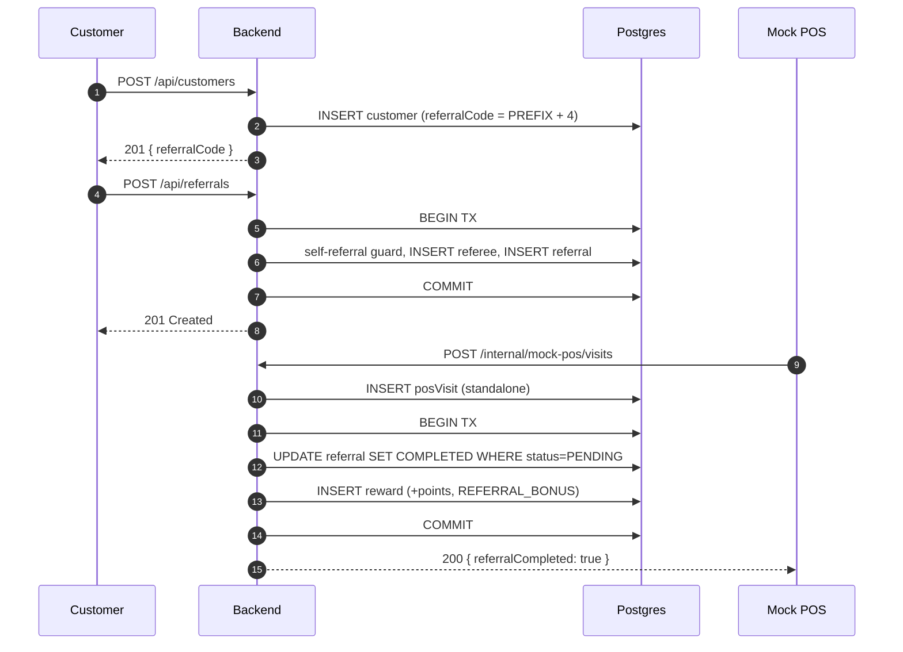
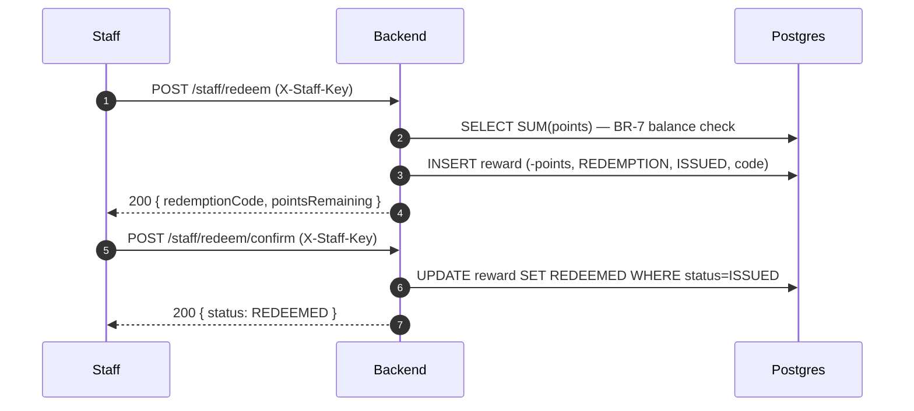

<!--
FILE: README.md
PURPOSE: Front door of the POS Referral & Loyalty monorepo — overview, quick start,
         repo layout, and pointers to docs/ which are the source of truth.
CALLED BY: Anyone opening the repo (humans + future AI sessions reading project context).
CALLS: Links to docs/SPEC.md, docs/API-CONTRACT.md, docs/DECISIONS.md, docs/CODE-WALKTHROUGH.md.
-->

# POS Referral & Loyalty System

Referral and loyalty features for the POS platform. Private project, Sprint 1 in progress.

**Source of truth lives in docs/.** If this README and a doc disagree, the doc wins.

---

## What this is

A backend + frontend for running referrals and loyalty points off a POS.
Backend (F1–F4) and the Customer + Staff pages are implemented; the Admin
page is a Sprint 3 placeholder. The contract and its rationale live in
`docs/API-CONTRACT.md` and `docs/DECISIONS.md`.

- Backend — Node.js 20 · TypeScript · Fastify · Prisma · PostgreSQL
- Frontend — React · Vite · Tailwind
- Tests — Vitest (unit + integration) · Playwright (E2E)
- Repo — monorepo (backend, frontend, docs)

---

## Architecture at a glance

Three layers, dependency direction strictly one-way:

    routes/*  →  usecases/*  →  prisma + settings loader
                              \── errors.ts (typed ApiError hierarchy)

- **Routes** are thin: parse input, call a usecase, serialize the response.
  No business logic.
- **Usecases** orchestrate domain + DB + settings. Never import Fastify.
- **Prisma** is reached only through the singleton in `backend/src/db/prisma.ts`.

Auth is by API key, plugin-scoped, no JWT:

    public     /api/*                 no auth
    staff      /staff/*               X-Staff-Key
    admin      /admin/*               X-Admin-Key
    internal   /internal/mock-pos/*   no auth (mock only)

Business config (points, expiry, code length) lives in the `settings`
table and is read through typed getters — nothing hardcodes a tunable
value. See `docs/DECISIONS.md #4`.

## Lifecycles

Two flows drive the product. Diagrams are rendered by GitHub; in a plain
editor they are just text blocks.

### Referral flow — register → invite → POS visit → completion

### Redemption flow — staff issues → customer uses → staff confirms

Full walkthrough: `docs/CODE-WALKTHROUGH.md`.

---

## Repository layout

    .
    backend/            # Fastify API + Prisma schema (Node 20 + TS)
      src/
      tests/
      prisma/
    frontend/           # React + Vite + Tailwind UI
      src/
      public/
    docs/               # SPEC, API contract, decisions, walkthrough
    .github/workflows/  # CI
    .env.example        # Root env template
    README.md           # this file

---
## Quick start (skeleton)

> End-to-end local run is wired up in a later sprint. These steps describe the intended flow.

### 1. Prerequisites

- Node.js 20.x
- PostgreSQL 15+ (local or Docker)
- npm 10+
- WSL or Linux/macOS shell

### 2. Environment files

Copy the templates and fill in local values. Never commit real .env files.

    cp .env.example .env
    cp backend/.env.example backend/.env
    cp frontend/.env.example frontend/.env

### 3. Install + run

    # Backend
    cd backend
    npm install
    npx prisma migrate dev
    npm run dev

    # Frontend (separate terminal)
    cd frontend
    npm install
    npm run dev

### 4. Tests

    cd backend && npm test         # Vitest
    cd frontend && npm test        # Vitest (placeholder)
    npx playwright test            # E2E (scaffolded later)

---

## Demo flow

Placeholder — will be filled in Sprint 3 once features are wired up.
Suggested outline:

1. Staff creates a referral for a customer at POS.
2. Customer receives a link / code.
3. Referred customer completes first purchase — points awarded.
4. Dashboard shows balance + referral status.
5. Expiry / rate values read from the settings table (see docs/DECISIONS.md #4).

---

## Docs

- docs/SPEC.md — full functional spec
- docs/API-CONTRACT.md — HTTP API contract (request / response)
- docs/DECISIONS.md — architecture decisions with WHY
- docs/CODE-WALKTHROUGH.md — guided tour (filled in Sprint 3)

---

## Branching & commits

- Branches: main + feature/* (PRs even when solo)
- Commits: Conventional Commits — feat:, fix:, test:, docs:, chore:
- CI: .github/workflows/ci.yml runs backend lint + typecheck + Vitest
  (auto-activates once backend/package.json exists)

---

## Status

Sprint 3 — in progress. Delivered so far:

- Backend (F1-F4) complete: customer register, referral create + complete,
  rewards + redemption, admin (referrals / redemptions / settings).
- Frontend Customer + Staff pages implemented; Admin page is a Sprint 3
  placeholder.
- Backend tests: 60 passed + 1 skipped.
- E2E: one Playwright spec (customer-flow) green in CI.
- CI: 3 jobs (Backend / Frontend / E2E), all green on main.
- Docs: SPEC, API-CONTRACT, DECISIONS, HANDOVER, CODE-WALKTHROUGH,
  QA-CHEATSHEET, plus per-team briefs under the project docs/.

Remaining for Sprint 3: Admin page, deploy to Render (stretch goal),
final polish.
