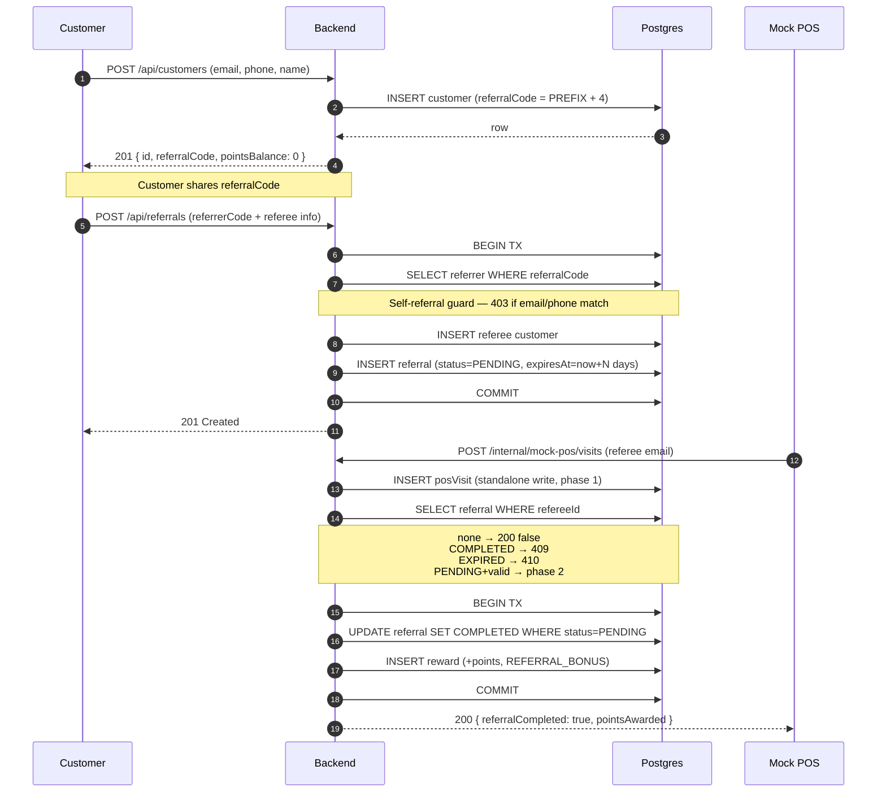
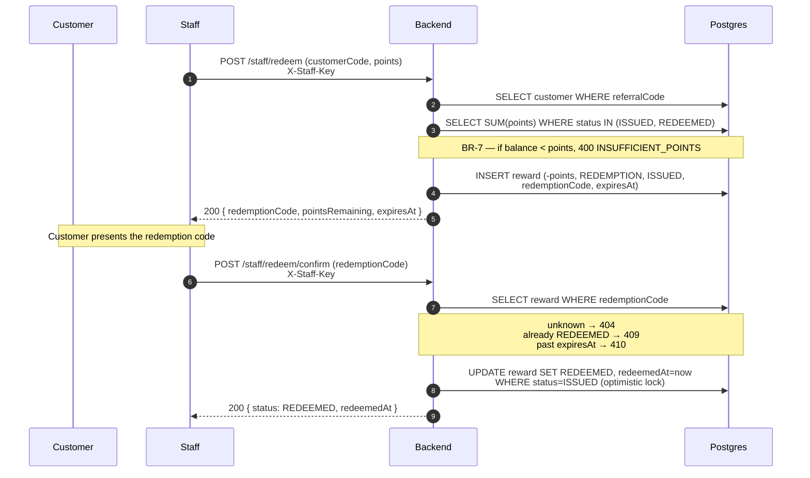

<!--
FILE: docs/CODE-WALKTHROUGH.md
PURPOSE: Guided tour of the codebase for three audiences — backend,
         frontend, and QA — with a focus on decisions, not syntax.
         Interview-friendly: every section says why the design is what
         it is, where the edges are, and where to change things.
READER: A contributor who has read docs/SPEC.md and
        docs/API-CONTRACT.md and now wants to understand the code.
LAST UPDATED: 2026-10-12 @ commit 32fb4a5 (Sprint 3 mid-flight).
SOURCE OF TRUTH: docs/SPEC.md, docs/API-CONTRACT.md, docs/DECISIONS.md.
-->

# CODE-WALKTHROUGH — POS Referral & Loyalty

## 0. How to read this document

Three audiences, three sections:

- **§1 Backend** — the request lifecycle, the atomic referral
  completion, the settings loader, and how auth works.
- **§2 Frontend** — the component tree, the transport layer, and the
  state flows behind the Customer and Staff pages.
- **§3 QA** — how the test suites are set up, how to add a case, and
  what Playwright covers.

§4 has two Mermaid diagrams covering the referral and redemption
lifecycles end to end.

Every section follows the same shape: **purpose → flow → why → change
points**. Syntax is assumed known; decisions are explained. Change
points are marked **[CHANGE POINT]** — search for that string when
you need to know where a future edit will land.

---

## 1. Backend walkthrough

### 1.1 The anatomy of a request — POST /api/referrals

Layering is enforced by dependency direction: routes know usecases,
usecases know Prisma and the settings loader, nothing points back up.

    HTTP  →  routes/referrals.ts        (thin adapter, no business logic)
          →  usecases/createReferral.ts (orchestration)
          →  db/prisma.ts + settings/loader.ts (infrastructure)
          →  Postgres

Step by step, a client POSTs /api/referrals:

1. **Fastify routes the request.** `app.ts` registers route groups in
   a fixed order — customerRoutes, referralRoutes, internalRoutes,
   staffRoutes (prefix `/staff`), adminRoutes (prefix `/admin`). Paths
   do not overlap, so the order is a readability choice, not a
   correctness one. The CORS plugin is registered only if
   `CORS_ORIGIN` is set — see §1.4 for why that matters for E2E.

2. **The route forwards the raw body.** `backend/src/routes/referrals.ts`
   does exactly this:

       const result = await createReferral(req.body);
       reply.status(201).send({ ...shape the response... });

   No Prisma, no settings, no business branches. The route's only job
   is to serialize the usecase result (Date → ISO string) and pick a
   status code.

3. **The usecase is where behavior lives.** `createReferral` runs, in
   order:
   - `CreateReferralInput.parse(input)` — zod validation. A ZodError
     bubbles uncaught; the global handler turns it into 400
     INVALID_INPUT with a `details` object keyed by field name.
   - `settings.getReferralExpiryDays()` — read the tunable from the DB
     (see §1.3). Deliberately called OUTSIDE the transaction so a cold
     cache read does not hold a connection while we do non-write work.
   - `prisma.$transaction(async (tx) => { ... })` — opens the write
     phase. Inside:
       a. Look up the referrer by `referralCode`; not found → 404
          REFERRER_NOT_FOUND.
       b. Self-referral guard: if referrer.email or referrer.phone
          matches the referee's, throw 403 SELF_REFERRAL.
       c. `createCustomerInTx(tx, {...})` — insert the referee. This is
          the same helper F1 uses, so code generation and the P2002
          retry loop live in exactly one place.
       d. Insert the Referral with `status: PENDING` and
          `expiresAt = now + expiryDays * MS_PER_DAY`. The deadline is
          snapshotted here (BR-4) — later settings changes do not move
          it retroactively.

   All four steps are one transaction. If (d) throws, the referee from
   (c) rolls back with it. No partial state survives.

4. **The response is shaped in the route, not the usecase.** The
   usecase returns a typed object; the route maps Dates to ISO strings.
   This keeps the usecase free of HTTP concerns and testable without a
   running server.

**[CHANGE POINT]** To add a validation rule, extend the zod schema.
To add a response field, extend `CreateReferralResult` AND the route's
`.send({...})` mapping — the interface is what the typechecker enforces.

WHY the self-referral check runs BEFORE the referee insert:

If we inserted first and checked after, a thrown 403 would leave an
orphan customer row unless the transaction rolled back. Doing the
cheap check first — two string comparisons — keeps the failure path
read-only. The atomicity test in `backend/tests/referrals.test.ts`
locks this in.

### 1.2 The referral completion transaction — POST /internal/mock-pos/visits

`backend/src/usecases/recordPosVisit.ts` is the most subtle usecase in
the codebase. It is also the only place where a Visit, a Referral
status change, and a Reward insert must agree on the same outcome.

**The two-phase shape.** SPEC §F2 is explicit: "visit still recorded;
no double reward". That single sentence forces a non-obvious structure:

    Phase 1 (standalone write)   → prisma.posVisit.create(...)
    Phase 2 (single transaction) → referral COMPLETED + reward ISSUED

Phase 1 is committed on its own. Phase 2 is wrapped in
`prisma.$transaction`. If phase 2 fails, phase 1 survives — this is the
SPEC contract, not a bug.

**State machine.** After loading the customer and the visit, the
usecase looks up the referral (by `refereeId`, which is UNIQUE — so a
`findUnique` is correct). The branch:

- **No referral** → return 200 `{ referralCompleted: false }`. The
  common case for repeat visits or non-referred customers.
- **Referral is COMPLETED** → 409 `REFERRAL_ALREADY_COMPLETED` with
  `visitId` in the response body. The visit was still recorded; the
  reward was not re-issued.
- **Referral is EXPIRED, or `expiresAt < now`** → lazily flip
  PENDING → EXPIRED on the row (no cron needed), then 410
  `REFERRAL_EXPIRED` with `visitId` in the body. No reward.
- **Referral is PENDING and valid** → enter phase 2.

**Phase 2 — the transaction.**

    const updated = await tx.referral.updateMany({
      where: { id: referral.id, status: PENDING },
      data:  { status: COMPLETED, completedAt: now }
    });
    if (updated.count === 0) throw ConflictError(...);
    await tx.reward.create({ ... points: +N, type: REFERRAL_BONUS ... });

Two guards prevent a double reward:

1. **Optimistic lock on `status: PENDING`.** `updateMany` returns
   `{ count }`. Two parallel callers both observe a PENDING referral,
   but only one can win the update. The loser sees `count === 0` and
   bails with 409 — no exception, no lost update.
2. **`UNIQUE(referralId, type)` on Reward.** If the optimistic lock
   somehow fails (e.g. a future code path bypasses it), the second
   `tx.reward.create` raises Prisma's P2002. `isPrismaUniqueViolation`
   catches it and re-raises the same 409. Belt and suspenders.

**Why two guards instead of one?** Because they defend different
failure modes. The lock defends against concurrency; the constraint
defends against programming error. Cheap to keep both.

**Points are read once, outside the transaction.** `pointsPerReferral
= await settings.getPointsPerReferral()` runs before
`$transaction(...)`. Same reason as §1.1: hold the tx open for the
minimum necessary duration.

**[CHANGE POINT]** If you add a new Referral status (e.g. CANCELLED),
the branch above is where the mapping lives. It is deliberately an
`if/else` chain and not a lookup table — with four states, the
explicitness pays for itself.

**[CHANGE POINT]** If you ever move to multi-terminal POS deployments,
the balance read at the top of `issueRedemption` would need the same
optimistic lock pattern as this usecase. It is intentionally omitted
here — single-staff MVP is documented in the file.

### 1.3 Settings loader — DB-backed business config

`backend/src/settings/loader.ts`. Everything tunable lives in the
`settings` table (DECISIONS #4), not in env vars. Points per referral,
referral expiry days, redemption expiry days, reward code length, and
the points-to-baht rate are all rows.

**Reads go through typed getters.**

    import { settings } from '../settings/loader.js';
    const days = await settings.getReferralExpiryDays();

There are two layers below that:

- A generic `settings.get(key): Promise<string>` — returns strings only,
  never `any`. Forces the caller to parse explicitly.
- Parse helpers `asInt` / `asFloat` / `asBool` that throw an
  `InternalError` on malformed values. A corrupted row is an ops
  problem, not a client problem — hence a 500, not a 400.

**The cache.** Every read checks a process-local map first:

    let cache: { values: Map<string, string>; loadedAt: number } | null

On a miss or after TTL, `loadAll()` fetches the entire `settings` table
in one query and swaps the cache. The TTL comes from
`SETTINGS_CACHE_TTL_SECONDS` (default 30). Reading the whole table is
cheap — currently 5 rows — and avoids a second roundtrip when a usecase
needs several values at once.

**Invalidation.** `settings.invalidateCache()` drops the cache
immediately. The only writer that calls it is
`usecases/updateSettings.ts`, and it does so AFTER the transaction
commits. That ordering is load-bearing: if the transaction throws, the
cache stays consistent with the DB.

**[CHANGE POINT]** To add a new setting:
1. Add the key + type + bounds + default to
   `backend/src/settings/schema.ts`. That single file is the source of
   truth — seed reads it, the admin PATCH validator reads it, and the
   loader's typed getters reference it.
2. Optionally add a getter to `loader.ts` if the key will be read
   often enough to deserve a typed name.
3. Re-run `npx prisma db seed` locally to insert the new row; on a
   deployed DB, PATCH /admin/settings or a manual INSERT.

Do not add a setting via env var. Every business value that an operator
might want to change in production belongs in the table.

### 1.4 Auth — plugin-scoped API keys

Three surfaces, three rules:

    public     /api/*                no auth
    staff      /staff/*              X-Staff-Key
    admin      /admin/*              X-Admin-Key
    internal   /internal/mock-pos/*  no auth (mock only)

**The mechanism is a plugin-scoped `onRequest` hook.** In
`routes/staff.ts` (and identically in `routes/admin.ts`):

    app.addHook('onRequest', async (req) => {
      const provided = req.headers['x-staff-key'];
      if (typeof provided !== 'string' || provided !== expectedKey) {
        throw new UnauthorizedError('Invalid or missing staff key');
      }
    });

Three reasons it is structured this way:

1. **Plugin scope.** The hook only applies to routes registered inside
   the plugin function. Removing the plugin removes both the routes and
   the auth in one move — no risk of a global hook accidentally gating
   a public endpoint.
2. **`onRequest`, not `preHandler`.** Runs before body parsing, so an
   unauthenticated request never has its payload read or validated.
3. **Fail-fast on missing config.** `readStaffKey()` throws at plugin
   registration if `STAFF_API_KEY` is unset. The process refuses to
   boot with a half-configured auth layer.

**Why header names are lowercase.** Fastify normalizes incoming header
names to lowercase, so `x-staff-key` is the canonical form for
comparison. HTTP itself is case-insensitive here; the lowercase is a
Fastify convention, not a spec requirement.

**Why no JWT.** Callers are services (the frontend, and eventually a
real POS), not end users. There is no identity to carry in a token —
see DECISIONS #5. When a first-party web UI with real user login
arrives, this is the file that changes.

**[CHANGE POINT]** To add a new role (e.g. a read-only auditor):
create `routes/auditor.ts`, mirror the hook, add a new env key. If
several roles will share the pattern, consider extracting a
`makeKeyAuthPlugin({ envVar, headerName })` factory — the two current
files are close enough to duplicate that a factory is a real option.

**The E2E CORS trap.** `app.ts` registers `@fastify/cors` only when
`CORS_ORIGIN` is set. Backend tests never notice because
`app.inject()` bypasses the network stack. E2E does not — the browser
at `:5173` performs a preflight before POST /api/customers. Without
`CORS_ORIGIN` in the E2E job env, the preflight fails, the register
form never submits, and the referral card never renders. Fixed in
commit 32fb4a5 by adding `CORS_ORIGIN: http://localhost:5173` to the
job env.

---

## 2. Frontend walkthrough

Scope: the Customer and Staff pages are implemented. The Admin page is
a placeholder; its walkthrough will land after Sprint 3 STEP 3.x.

### 2.1 The component tree

    main.tsx
      └─ StrictMode
          └─ BrowserRouter
              └─ App
                  └─ Routes
                      ├─ (Layout wrapper — renders nav + <Outlet/>)
                      │    ├─ /           → Navigate → /customer
                      │    ├─ /customer   → CustomerPage
                      │    ├─ /staff      → StaffPage
                      │    ├─ /admin      → AdminPage (placeholder)
                      │    └─ *           → Navigate → /customer
                      └─ (no top-level route without Layout)

Why Layout is a parent route instead of a per-page wrapper: the nav
chrome is one concern, and it should change in one file. A new page
inherits it by being a child route; there is no way for a page to
forget the shell.

Why root redirects to /customer: the referral flow is customer-first —
a shared link points at a customer code, and staff/admin are explicit
destinations reached by the operator, not the default audience.

**[CHANGE POINT]** Adding a route means one `<Route>` in `App.tsx` and,
for the nav to surface it, one entry in `Layout.tsx`'s `NAV_ITEMS`.
The two lists are small enough not to warrant a shared config today;
revisit when there are more than ~5 pages.

### 2.2 The transport layer

Three small files under `frontend/src/`:

- `lib/api.ts` — `request<T>(path, opts)` and a typed `ApiError`
- `hooks/useApi.ts` — GET with auto-fetch, exposes
  `{ data, loading, error, refetch }`
- `hooks/useMutation.ts` — POST/PATCH/DELETE with
  `{ run, loading, error, data, reset }`

`request<T>` is the only thing that touches `fetch`. It:

- Reads the base URL from `import.meta.env.VITE_API_URL` at module load
  and throws if it is unset. That throw is what the E2E job had to work
  around (see §1.4 — the CORS trap is the same trap, one layer up).
- Injects `Content-Type: application/json` when a body is present and
  `X-Staff-Key` / `X-Admin-Key` when the caller passes them.
- Parses the response. On a non-2xx it throws `ApiError` with the
  backend's `{ error, code, details }` shape flattened into
  `status`, `code`, `message`, `details`.
- Treats 204 as `undefined` — endpoints without a body do not go
  through `JSON.parse`.

`useApi` is intentionally minimal:

    const customer = useApi<Customer>(`/api/customers/${code}`);

- Fires once on mount, and again when the caller-provided `deps` array
  changes. The `deps` parameter exists because the hook deliberately
  does NOT depend on `options` (inline objects would change identity
  every render and create a fetch loop).
- Guards every `setState` behind a mounted-ref so navigating away mid-
  request does not warn.

`useMutation` is the mirror image:

    const redeem = useMutation<IssueRedemptionInput, IssueRedemptionResponse>({
      method: 'POST',
      path: '/staff/redeem',
      auth: { staffKey }
    });
    await redeem.run({ customerCode, points });

- `run` returns the parsed body AND stores it in `data`; it re-throws
  the `ApiError` so the caller can branch on `err.code` (e.g.
  INSUFFICIENT_POINTS) inside a try/catch while the banner renders from
  `redeem.error`.

**Why not TanStack Query.** Three pages, no shared cache requirements,
no optimistic updates. The two hooks are ~180 lines total and are
easier to explain than the mental model behind a query cache. If a
future feature needs shared state or offline behaviour, that is the
moment to reconsider — not before.

**Why raw `fetch` instead of `axios`.** `fetch` is browser-native,
aborts via `AbortController`, and needs no dependency. The wrapper is
small enough that a library would add surface area without reducing
lines.

**[CHANGE POINT]** Adding a new endpoint call means picking the right
hook: `useApi` for reads tied to a page mount, `useMutation` for
user-triggered writes. Both wrap `request<T>` — do not call `fetch`
directly from a component.

### 2.3 The Customer page — state flow

`frontend/src/pages/Customer.tsx` is a thin dispatcher over two
internal views. All persistent state is one string: the customer's
`referralCode`.

**Mount.** The page reads the stored code exactly once via a lazy
`useState` initializer:

    const [code, setCode] = useState<string | null>(() =>
      getStoredReferralCode()
    );

The lazy form matters: a plain `getStoredReferralCode()` call would run
on every render. The lazy initializer runs once, at first paint.

**Branch.** If `code === null`, render `<RegisterForm/>`; otherwise
render `<CustomerView referralCode={code}/>`.

**RegisterForm → success.** On 201, the form calls
`onSuccess(customer)`. The page:

    setCode(customer.referralCode)

The code is now held in React state AND persisted by `RegisterForm`
via `setStoredReferralCode`. Subsequent renders read the state, not
storage.

**CustomerView.** Loads three things in parallel:

- `GET /api/customers/:referralCode` — the customer record
- `GET /api/customers/:referralCode/rewards` — balance + history
- `GET /api/customers/:referralCode/referrals` — the referral list

All three are `useApi` calls with a shared `refreshKey` dependency.
A "Refresh" button bumps `refreshKey`, which re-fires all three.

**404 self-heal.** If the customer endpoint 404s (the code was
deleted, or the API changed shape), `CustomerView` calls
`onInvalidCode()`. The page clears storage via
`clearStoredReferralCode()` and sets `code` back to null, which drops
the user back to the register form. No modal, no error state that
requires manual recovery.

**RefereeForm.** Submits `POST /api/referrals` with the parent's
`referralCode` as `referrerCode`. Success shows a
`data-testid="referee-success"` banner. No email is sent in the MVP —
the message is a UI acknowledgement, not a delivery receipt.

**Storage layer.** `frontend/src/lib/storage.ts` wraps every
localStorage call in try/catch. Three reasons:

- Safari private mode and some cookie-restricted contexts throw on
  write.
- The referral code is not the source of truth — the server is. Losing
  the local cache costs a re-entry, not the referral itself.
- The wrapper is the only file that knows the storage key
  (`pos-referral-loyalty.customer.referralCode`), so a key change is
  one edit.

### 2.4 The Staff page — state flow

`frontend/src/pages/Staff.tsx` follows the same pattern: a wrapper
holds one piece of persistent state (the staff key), and three
sub-components do the work.

**Mount.** Reads the staff key from storage once:

    const [staffKey, setStaffKey] = useState<string | null>(() =>
      getStoredStaffKey()
    );

**Branch.** If `staffKey === null`, render `<StaffKeyPrompt/>`.
Otherwise render `<CustomerLookup/>` and, once a customer is found,
`<RedemptionForm/>` and `<ConfirmRedemptionForm/>`.

**StaffKeyPrompt.** Takes a key, tries it against a real endpoint
(a lookup is the cheapest way to validate without a dedicated
endpoint), and only calls `onAccepted(key)` on success. Persists via
`setStoredStaffKey`.

**CustomerLookup.** Fires `GET /api/customers/:referralCode` with the
`X-Staff-Key` header. On 200 it calls `onFound(customer)`; the page
stores the customer in state so both forms below can reference the
same object without re-fetching.

**RedemptionForm.** Submits `POST /staff/redeem`. On 200 it shows the
returned `redemptionCode` and `pointsRemaining` (from the response,
not recomputed) — the customer-facing contract is the response body,
not our local arithmetic.

**ConfirmRedemptionForm.** Submits `POST /staff/redeem/confirm`. On
200 it shows the success message. The two forms are deliberately
separate: one issues, one confirms, and mixing them into a single
form would conflate a workflow that is intentionally two-step.

**One 401 handler.** Both mutation forms receive an `onError` callback
from the page. If the thrown `ApiError.status === 401`, the page:

    clearStoredStaffKey();
    setStaffKey(null);
    setCustomer(null);

Three things happen atomically so the next render lands the user on
the key prompt with no stale state. Any other status is left to the
form's own `ErrorBanner` — the page does not swallow it, so the
operator sees the real message.

**Why storage, not React context.** The staff key is a browser-scoped
credential, not app state. Persisting it means an operator does not
re-enter it on every reload. Putting it in context would not survive
a tab refresh and would tempt us into a React-level auth abstraction
that the MVP does not need.

**[CHANGE POINT]** If the redemption flow ever grows a third step
(refund, void), the pattern is: a new `<XForm/>` component receives
`staffKey` + `onError`, and the page adds it to the `customer !==
null` branch.

### 2.5 The data-testid contract

Every interactive element and every assertion target has a
`data-testid`. QA's Playwright specs depend on these strings and
nothing else — class names, text content, and DOM structure are
implementation details that may change without notice.

The contract, grouped by page:

**Customer — register**
    register-form              form container
    register-email             input
    register-phone             input
    register-name              input
    register-submit            button

**Customer — post-register**
    referral-code              the shareable code (text)
    copy-button                copies to clipboard
    points-balance             current balance (text)
    referral-list              container for the referral rows
    referee-form               invite-a-friend form container
    referee-email              input
    referee-phone              input
    referee-name               input
    referee-submit             button
    referee-success            success message after invite

**Cross-page**
    error-banner               inline error surface

**Staff — key prompt**
    staff-key-form             form container
    staff-key-input            input
    staff-key-submit           button

**Staff — customer lookup**
    staff-customer-form        form container
    staff-customer-input       input
    staff-customer-submit      button

**Staff — issue redemption**
    redeem-form                form container
    redeem-points-input        input
    redeem-submit              button
    redemption-code            returned code (text)
    redemption-remaining       remaining balance (text)

**Staff — confirm redemption**
    redeem-confirm-form        form container
    redeem-code-input          input
    redeem-confirm-submit      button

**The rule.** Renaming a testid is a breaking change to the E2E
suite. QA does not edit Frontend code; Frontend does not edit E2E
specs. If a new testid is needed, land it as two commits: the
frontend adds the attribute, QA updates the spec.

**[CHANGE POINT]** New form fields require a new testid. Follow the
existing naming — verb-noun for actions (register-submit,
referee-success), noun-state for reads (referral-code, points-balance).
This is not enforced by tooling; the convention is the enforcement.

**Admin-page testids.** They were added with the implementation and follow
the same naming rule; keep new hooks consistent with the list above.

---

## 3. QA walkthrough

Scope: backend integration tests (`backend/tests/*.test.ts`, vitest)
and the Playwright E2E layer (`tests/e2e/*.spec.ts`). QA does not edit
source code; bugs are reported with the failing assertion
and the seed data.

### 3.1 The test environment

**Backend integration tests run against a real Postgres** — no mocks,
no in-memory substitute. `app.inject()` drives the same Fastify
instance production uses:

    const app = await buildApp({ logger: false });
    const res = await app.inject({ method: 'POST', url: '/api/customers', payload });

Two reasons for this choice:

1. **`$transaction` behaviour cannot be faked.** The referral-completion
   flow (§1.2) depends on real serialization, real UNIQUE constraints,
   and real rollback semantics. A mock would test the mock.
2. **The bugs we care about live at the DB boundary.** Missing
   constraints, wrong index direction, race conditions — those only
   surface against a real engine.

The cost is setup: every suite needs the DB to be migrated and seeded.
Locally that is `docker compose up -d && npx prisma migrate dev && npx
prisma db seed`. In CI, the backend and E2E jobs each spin up a
`postgres:16-alpine` service container and run the same three commands
before the test step.

**`fileParallelism: false` in `backend/vitest.config.ts`.** Suites
share one database, and parallel files race on `COUNT(*)`,
`findMany({ orderBy })`, and pagination assertions. Serial execution
costs ~1 second at the current scale and eliminates the class of flake
entirely. See §1.2's commit trail for the run where this bit.

**Why not testcontainers.** The Postgres service is one line in CI and
one line in `docker-compose.yml`. Testcontainers would add a runtime
dependency, a Docker socket requirement, and a per-suite startup cost
that is not warranted by the current suite count.

### 3.2 The prefix convention

Suites share one Postgres, so test data must be reachable for cleanup
without touching production-shaped rows. Every suite claims a unique
email and phone prefix:

    prefix                    suite
    test-customer-            tests/customers.test.ts
    test-referral-            tests/referrals.test.ts
    test-cust-ref-            tests/customer-referrals.test.ts
    test-posvisits-           tests/pos-visits.test.ts
    test-rewards-             tests/rewards.test.ts
    test-admin-               tests/admin.test.ts
    test-settings-loader      (internal key in settings.test.ts)

Cleanup runs in FK order — child rows first:

    reward  →  referral  →  posVisit  →  customer

The order matters: `reward` references both `referral` and `customer`;
`referral` references `customer` twice (referrer + referee). Dropping
parents before children would fail on the FK constraint. The `afterAll`
hook in every suite follows the same sequence.

**Why prefixes and not transaction rollback per test.** A single
wrapping transaction would work for setup, but the usecases under test
open their own transactions (§1.1, §1.2). Prisma does not support
nested transactions with independent rollback. Prefixes + explicit
cleanup is the pragmatic pattern.

### 3.3 Adding a new backend test case

The recipe, in order:

1. **Pick the suite.** If the endpoint already has one, extend it. A
   new endpoint gets a new file (see `customer-referrals.test.ts` for
   the smallest complete example).

2. **Reuse the suite's helpers.** Most suites declare
   `createCustomerViaApi` / `postVisit` / `seedReward` at the top. Do
   not re-invent them per test — the helper is what keeps the setup
   short and the failure surface narrow.

3. **Set up the state.** Prefer the API for anything the API can
   produce; use direct Prisma only when the state you need is not
   reachable through an endpoint (e.g. an expired deadline — see the
   EXPIRED case in `pos-visits.test.ts`).

4. **Assert.** One positive shape assertion per endpoint call. If the
   API contract pins a shape, one `toMatchObject` covers it; stacked
   `expect`s on the same response are noise.

5. **Clean up in `afterAll`.** The suite already does this — do not
   add a per-test cleanup unless the test is destructive. Prefixes
   guarantee the sweep finds every row the suite created.

Every test file starts with a Rule #6 header: FILE / PURPOSE /
CALLED BY / CALLS. The `PREREQUISITES` line at the bottom of the
header documents the environment needs (Postgres, migrations, seed).

**Determinism rules.** No `Date.now()` snapshots without a tolerance
window (see the `expiresAt` test in `referrals.test.ts` — ±5s). No
reliance on execution order beyond what `fileParallelism: false`
already guarantees. No parallel test cases inside a suite.

### 3.4 Playwright — one spec, one flow

`tests/e2e/customer-flow.spec.ts` walks a single end-to-end journey:

    /customer
      → register a new customer (unique email + phone per run)
      → assert referral code appears, balance is "0", list is empty
      → invite a referee (fills and submits the referee form)
      → assert the success banner

That is the whole scope for Sprint 3. Deliberately narrow: a single
spec that passes reliably is worth more than five that flake.

**The `beforeEach` hook resets state:**

    await page.goto('/customer');
    await page.evaluate(() => window.localStorage.clear());
    await page.reload();

The clear + reload is what makes the spec rerunnable. Without it, the
second run would find a stored `referralCode` and skip the register
form — the exact opposite of what the spec wants.

**Unique data per run.** `crypto.randomUUID()` (Node 20 global, no
import) generates an email suffix and, via a counter, a phone number.
Fixed values would 409 on the second run against a non-empty DB.

**Selectors are `data-testid` only.** See §2.5 for the contract. Text
matching and class selectors are forbidden in critical paths — the
former is brittle to copy changes, the latter to style churn.

**Chromium only, one worker.** The config sets `workers: 1` and
`retries: 1` on CI. One browser keeps the CI job within the 10-minute
budget; one worker keeps two tests from fighting over the same
localStorage origin.

**[CHANGE POINT]** Adding a new E2E flow:
1. Create a new spec under `tests/e2e/`.
2. Reuse the `data-testid` contract from §2.5 — do not add selectors
   that are not in the table.
3. If you need a new testid, add it in a small frontend change first.
   QA does not edit Frontend code.

---

## 4. Lifecycle diagrams (Mermaid)

GitHub renders the two fences below. In a plain-text editor they are
just code blocks — the content between them is the diagram source.

### 4.1 Referral flow — register → invite → POS visit → completion

**[CHANGE POINT]** The two transaction boundaries are the
load-bearing detail. Phase 1 (visit) is a standalone write — the
SPEC requires the visit to survive a rejected referral. Phase 2
(completion) is atomic — a partial state would break BR-3. The
optimistic lock on `status = PENDING` is what makes the branch
race-safe.

### 4.2 Redemption flow — staff issues → customer uses → staff confirms

**[CHANGE POINT]** The issue step deliberately does NOT wrap the
balance read in a transaction (see the WHY comment in
`issueRedemption.ts`). Under a single-staff POS workflow, two
concurrent issue calls for the same customer are not realistic.
Multi-terminal deployments would need SERIALIZABLE isolation or a
balance advisory lock — tracked as a known limitation, not fixed
in the MVP.

---

## 5. Change log

- **Sprint 1 (`f1df4ce`)** — skeleton with section headings and TODO
  markers.
- **Sprint 3 (this commit)** — full content: §1 backend (§1.1–§1.4),
  §2 frontend Customer + Staff (§2.1–§2.5), §3 QA (§3.1–§3.4),
  §4 Mermaid diagrams, §5 change log. Admin page walkthrough is
  deferred to a follow-up commit once the page is implemented.

Maintained by the project maintainer. Append a line to §5 whenever
a section lands or an existing one meaningfully changes.

---

## Footer

If this document and the code disagree, the code wins — but fix the
document in the same PR that changed the code. Every section name
has a matching concept in the repo; navigate with:

    grep -n '\[CHANGE POINT\]' docs/CODE-WALKTHROUGH.md
